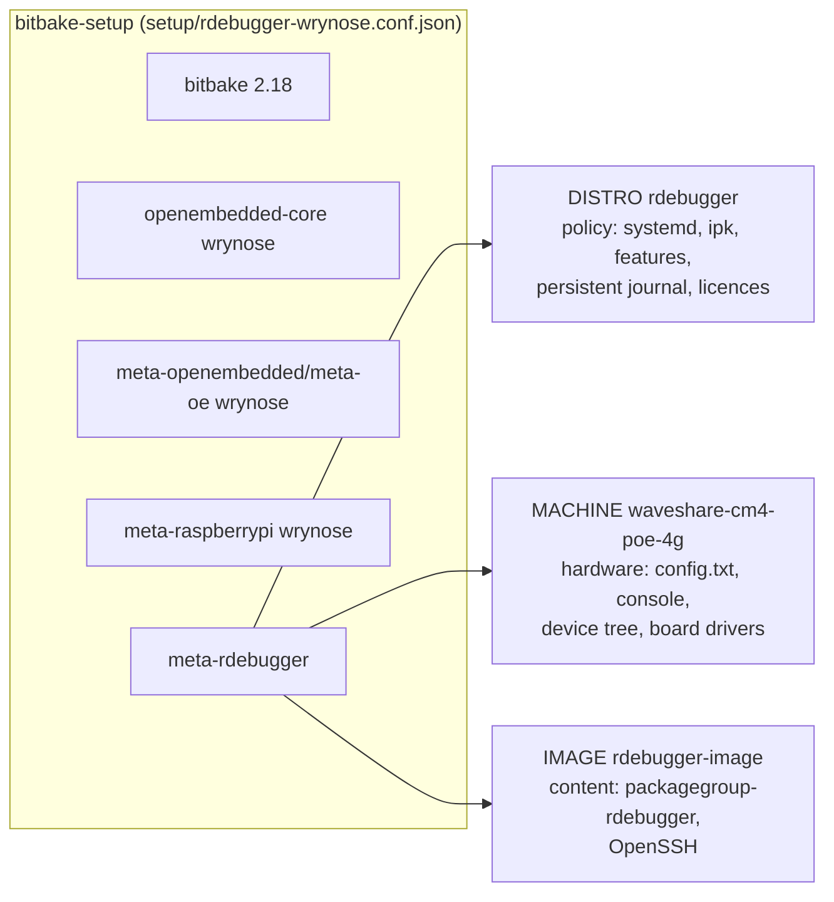
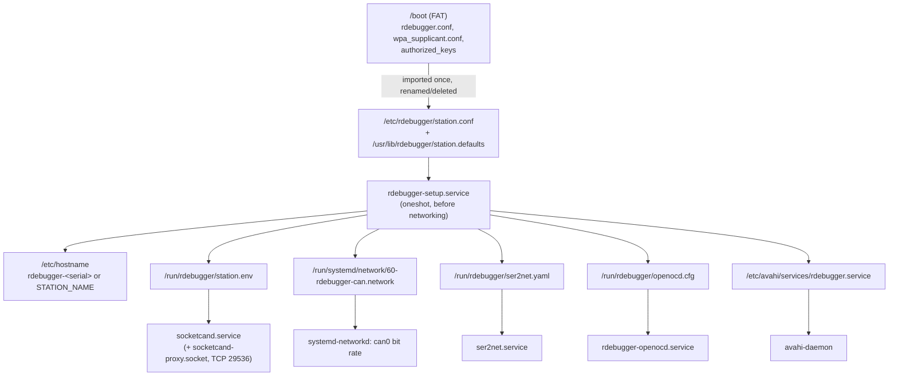

# Architecture

rdebugger turns a Raspberry Pi CM4 on a carrier board into a **bench node**: a
thin, deterministic host that puts a target's debug port, console, CAN bus and
1-Wire bus on the network. Intelligence (engineers, agents, CI) runs elsewhere
and connects over TCP.

## Where it fits

The [Agentic Hardware Development operating model](https://claude.ai/code/artifact/756932dc-5d3b-49b7-ab2d-43a147fa8de7)
defines the bench side of the pipeline. rdebugger implements the parts that
must sit physically at the device:

| Operating-model requirement | rdebugger today | Later |
| --- | --- | --- |
| Universal module interface: 24 V, CAN, 1-Wire, JTAG | CAN (MCP2515 + socketcand), 1-Wire master (w1-gpio), SWD/JTAG (OpenOCD + ST-LINK) | 24 V via a Modbus-TCP supply (pooled instrument), switch matrix |
| Bench nodes are thin, deterministic instrument hosts; Raspberry Pi where GPIO/HATs must sit at the device | Read-mostly image, one config file, no build tools, fixed service ports | Read-only rootfs and A/B updates |
| Benches sit on their own network segment | Services bind to all interfaces with no authentication (see [ADR 0006](adr/0006-unauthenticated-services-on-bench-segment.md)) | Firewall/VLAN at deployment |
| Each bench registered as a self-hosted CI runner with capability labels | mDNS `_rdebugger._tcp` advertisement with TXT records (target, ports, CAN bit rate) | CI runner registration from those labels |
| Tool layer: typed tools with bounded operations; agents never get raw shell | Network services (GDB, ser2net, socketcand) are the primitive the tool layer wraps; SSH is for humans | Typed tool service on the node |
| Evidence capture: every call logged, timestamped and signed at the node | Persistent journal, RTC + NTP time | Signed evidence log |
| Node identity from the module's 1-Wire ID chip | 1-Wire master + DS2431/DS2433/DS28E04 slave drivers, IDs in sysfs | Identity service feeding the J1939 NAME mapping |

## Layers and responsibilities

The split follows Yocto convention so the carrier board can change without
touching policy:

- **Distro** (`conf/distro/rdebugger.conf`): how the system behaves on any
  hardware (init system, packaging, features, logging, hostname policy).
- **Machine** (`conf/machine/waveshare-cm4-poe-4g.conf`): what this board has.
  It derives from `raspberrypi4-64` so every meta-raspberrypi override still
  applies. Our own carrier board becomes a new machine file next to it
  ([ADR 0002](adr/0002-machine-per-carrier-board.md)).
- **Image** (`rdebugger-image`): what is installed, grouped by job in
  `packagegroup-rdebugger` (base, debug, serial, can, onewire, tools).
- **Configurations** (`rdebugger-dev`, `rdebugger-release`) differ only by
  fragments: dev adds passwordless root and gdb/strace.

## Runtime: from one config file to running services

All station behaviour that may differ between benches comes from
`/etc/rdebugger/station.conf` (defaults in `/usr/lib/rdebugger/station.defaults`).
`rdebugger-setup` turns it into generated files under `/run` on every boot
([ADR 0003](adr/0003-runtime-station-configuration.md)):

Change a setting at runtime with `nano /etc/rdebugger/station.conf` then
`rdebugger-setup apply` (regenerates and restarts the affected services).

## Boot sequence

1. Firmware reads `config.txt` (overlays for CAN, RTC, UARTs, 1-Wire, USB host)
   and starts the kernel from the eMMC (`root=/dev/mmcblk0p2`).
2. systemd mounts `/` and `/boot`. On the first boot only,
   `rdebugger-growfs.service` grows the root partition to fill the eMMC.
3. `rdebugger-setup.service` imports provisioning files, sets the hostname
   and generates the runtime configuration (ordered before `network-pre.target`).
4. systemd-networkd brings up `eth0` (DHCP, IPv4 link-local fallback), `can0`
   (bit rate from station.conf) and `wlan0`; udev starts
   `wpa_supplicant-nl80211@wlan0` when wlan0 appears, and it runs only if Wi-Fi
   is provisioned. No station service waits for `network-online.target`
   (if a unit asks for it, it means eth0 online, at most 30 s).
5. avahi-daemon advertises `<hostname>.local`, `_ssh._tcp` and `_rdebugger._tcp`.
6. ser2net (TCP 3000/3001) and socketcand start; socketcand listens on a local
   socket and `socketcand-proxy.socket` serves it on TCP 29536 on every address,
   so it does not depend on which link or address is up. OpenOCD starts only
   when an ST-LINK is present (udev), and stops when it is unplugged.
7. systemd feeds the BCM2711 hardware watchdog (30 s). The journal is
   persistent (capped at 128 MB).

## Services

| Unit | Started by | Runs as | Config |
| --- | --- | --- | --- |
| `rdebugger-setup.service` | boot (oneshot) | root | station.conf |
| `rdebugger-growfs.service` | first boot (oneshot) | root | - |
| `systemd-networkd` | boot | systemd-network | `/usr/lib/systemd/network/20-eth0.network`, `30-wlan0.network`, generated CAN file |
| `wpa_supplicant-nl80211@wlan0` | udev, when wlan0 appears; runs only if provisioned | root | `/etc/wpa_supplicant/wpa_supplicant-nl80211-wlan0.conf` |
| `avahi-daemon` | boot | avahi | `/etc/avahi/services/` |
| `sshd.socket` | boot (socket-activated) | root | `/etc/ssh/sshd_config` |
| `ser2net.service` | boot | dynamic user, group dialout | `/run/rdebugger/ser2net.yaml` |
| `socketcand.service` | boot | dynamic user | `/run/rdebugger/station.env`; listens on `/run/socketcand/socketcand.sock` |
| `socketcand-proxy.socket` / `.service` | boot (socket-activated) | dynamic user | TCP 29536 on all addresses, forwarded by `systemd-socket-proxyd` |
| `rdebugger-openocd.service` | udev, ST-LINK plugged in | dynamic user, group plugdev | `/run/rdebugger/openocd.cfg` |
| `systemd-timesyncd` | boot | systemd-timesync | NTP from DHCP or systemd's fallback servers |

## Security model

The network services (GDB server, OpenOCD telnet/Tcl, ser2net, socketcand) have
**no authentication**. That is acceptable only on an isolated bench segment, as
the operating model requires ([ADR 0006](adr/0006-unauthenticated-services-on-bench-segment.md)).
Services run as unprivileged dynamic users where possible. The dev configuration
additionally allows passwordless root over SSH; release builds accept SSH keys
only (provision them with `authorized_keys` on the boot partition).
